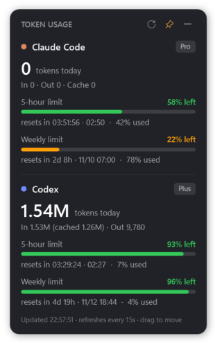

# Token Gauge

[简体中文](README.zh-CN.md) | English

A small always-on-top Windows desktop widget that shows your **Claude Code** and **Codex** usage at a glance: today's tokens, how much of your plan's 5-hour and weekly limits is left, and a live countdown to the next reset. No more opening the Usage page every few minutes.

> **Unofficial project.** Not affiliated with, endorsed by, or supported by Anthropic or OpenAI. "Claude" and "Codex" are trademarks of their respective owners and are used here only to describe what the tool reads.

<p align="center"></p>

## Features

- **Today's tokens** for Claude Code and Codex, with input / output / cache breakdown
- **Plan limits left** for the 5-hour window and the weekly window, as colored bars
  (green above 50 % left, amber 20–50 %, red below 20 %)
- **Live reset countdown** and local reset time
- **Low-quota notifications** when a limit drops below 20 % and 10 % (configurable)
- Tray icon whose color follows your tightest limit; right-click menu for always-on-top, start with Windows, refresh, exit
- **5 UI languages**, switchable live from the tray menu: English, 简体中文, 繁體中文, 日本語, 한국어 (follows your Windows language by default)
- Draggable, remembers its position
- Single PowerShell script on the built-in **Windows PowerShell 5.1 + WPF**. Nothing to install, no admin rights, no telemetry

## Requirements

- Windows 10 or 11
- **Codex**: the Codex CLI / app signed in with a ChatGPT plan. Data is read from `%USERPROFILE%\.codex\sessions`
- **Claude Code**: the Claude Code CLI signed in with a Claude subscription (Pro / Max), see below

## Install

1. Download the latest `token-gauge-x.y.z.zip` from [Releases](../../releases) and **extract the whole zip**.
2. Double-click **`install.cmd`**.
3. Answer whether it should start with Windows. The widget appears at the top-right of your screen.

It installs per-user to `%LOCALAPPDATA%\Programs\TokenGauge` and adds a **Token Gauge** entry to the Start menu.
To remove it, use **Uninstall Token Gauge** in the Start menu, or run `uninstall.cmd`.

> Windows SmartScreen or your antivirus may warn about scripts downloaded from the internet. All of the code is plain-text PowerShell in this repository, so you can read it before running.

### Getting the Claude quota to show

The Claude plan limits come from the same usage endpoint Claude Code itself uses, so Token Gauge needs the login token that the **Claude Code CLI** stores in `%USERPROFILE%\.claude\.credentials.json`. If you only use Claude through the desktop app, sign in to the CLI once:

```powershell
irm https://claude.ai/install.ps1 | iex   # install Claude Code CLI (official installer)
claude                                     # choose "Claude account with subscription" and sign in
```

The CLI renews this token whenever you run `claude`. If you haven't run it for a while the widget will say the token expired. Run `claude` once and it recovers. Token Gauge only **reads** the token and never modifies it.

## Where the numbers come from

| Shown | Claude Code | Codex |
|---|---|---|
| Today's tokens | Local session logs `~\.claude\projects\**\*.jsonl` (also the desktop app's local sessions) | Local session logs `~\.codex\sessions\**\rollout-*.jsonl` |
| 5-hour / weekly limits | `GET https://api.anthropic.com/api/oauth/usage` with your Claude Code token | `rate_limits` recorded in the latest Codex session log |

Notes:

- **Cloud sessions are not counted in "today's tokens".** Sessions that run in the cloud (for example Claude Code on the web or cloud sessions in the desktop app) leave no logs on your PC. Their usage still counts toward the plan limits, which are shown correctly.
- **Codex limits update when you use Codex.** The values are as of your last Codex request. Once the reset time passes, the bar shows the window as reset.
- Token totals include cache reads/writes, matching what the logs record. Subscription plans don't publish token-based limits, so the percentage bars are the numbers that actually matter.
- The Claude usage endpoint is **undocumented** and may change or stop working without notice.

## Privacy

- Reads only local files under your user profile plus the one Anthropic usage endpoint above.
- Sends nothing anywhere else. No analytics, no update checks.
- Settings and an error log live in `%APPDATA%\TokenGauge`.

## Settings

To change the language, right-click the tray icon → **Language** and pick one. It switches immediately and is remembered.

For the other settings: right-click the tray icon → *Open settings folder*, edit `settings.json`, then restart the widget.

| Key | Default | Meaning |
|---|---|---|
| `Language` | `"auto"` | `"auto"`, `"en"`, `"zh-CN"`, `"zh-TW"`, `"ja"` or `"ko"` |
| `Thresholds` | `[20, 10]` | Notify when remaining % drops to these values |
| `LocalRefreshSec` | `15` | How often local logs are rescanned (min 5) |
| `QuotaRefreshSec` | `120` | How often the Claude quota is fetched (min 60) |
| `Topmost` | `true` | Keep the widget above other windows |

Environment variables `CLAUDE_CONFIG_DIR` and `CODEX_HOME` are respected.

## Troubleshooting

- **Nothing appears:** check the tray (click `^` to see hidden icons). Run `powershell -ExecutionPolicy Bypass -STA -File "%LOCALAPPDATA%\Programs\TokenGauge\TokenGauge.ps1"` from a terminal to see errors, and look in `%APPDATA%\TokenGauge\error.log`.
- **Claude: "login not found":** sign in to the Claude Code CLI, see above.
- **Claude: "network error":** the widget uses your system proxy settings. Make sure `api.anthropic.com` is reachable.
- **Codex shows no limits:** use Codex once. Limits are only recorded when a request is made.

## Contributing

Issues and pull requests are welcome. Translations other than English and Simplified Chinese were written without a native-speaker review, so corrections are especially welcome; all UI text lives in the `$Strings` table near the top of `src/TokenGauge.ps1`, and adding a language means copying the `en` block and adding its code to `$LangOrder`. Log formats of Claude Code and Codex change from time to time; if numbers look wrong after an update, please open an issue with your tool versions and a screenshot (redact anything private).

## License

[MIT](LICENSE)
