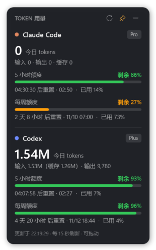

# Token Gauge

简体中文 | [English](README.md)

一个常驻桌面的 Windows 小悬浮窗，随时显示 **Claude Code** 和 **Codex** 的用量：今日 token、套餐 5 小时额度和每周额度剩余多少、距离下次重置的倒计时。不用再一遍遍打开 Usage 页面。

> **非官方项目**，与 Anthropic、OpenAI 无任何关联，也未获其认可或支持。"Claude""Codex"是各自所有者的商标，本项目只用它们说明读取的是哪个工具的数据。

<p align="center"></p>

## 功能

- Claude Code 和 Codex 的**今日 token**，并拆分输入 / 输出 / 缓存
- **5 小时额度和每周额度的剩余比例**，用彩色进度条显示：剩余 50% 以上绿色，20%–50% 橙色，20% 以下红色
- 重置**倒计时**（每秒刷新）和本地重置时间
- **额度不足提醒**：剩余低于 20% 和 10% 时弹出系统通知（阈值可改）
- 托盘图标颜色跟随最紧张的那项额度；右键菜单可设置置顶、开机自启、立即刷新、退出
- **支持 5 种界面语言**，可在托盘菜单里随时切换，立即生效：English、简体中文、繁體中文、日本語、한국어（默认跟随 Windows 系统语言）
- **贴边自动隐藏**：拖到屏幕左、右或上边缘松开就会收起，只留一个小标记，点标记再弹出来
- 可拖动并记住位置
- 只有一个 PowerShell 脚本，基于 Windows 自带的 **PowerShell 5.1 + WPF**：不用装任何依赖，不需要管理员权限，不收集任何数据

## 系统要求

- Windows 10 / 11
- **Codex**：已登录 ChatGPT 账号的 Codex 命令行版或应用，数据从 `%USERPROFILE%\.codex\sessions` 读取
- **Claude Code**：用 Claude 订阅（Pro / Max）登录过 Claude Code 命令行版，见下文

## 安装

1. 从 [Releases](../../releases) 下载最新的 `token-gauge-x.y.z.zip`，**完整解压**。
2. 双击 **`install.cmd`**。
3. 选择是否开机自动启动，悬浮窗随即出现在屏幕右上角。

程序按当前用户安装到 `%LOCALAPPDATA%\Programs\TokenGauge`，开始菜单里会出现 **Token Gauge**。
卸载：在开始菜单运行 **Uninstall Token Gauge**，或双击 `uninstall.cmd`。

> 从网上下载的脚本可能触发 SmartScreen 或杀毒软件提示。代码全部是本仓库里的纯文本 PowerShell，运行前可以自行查看。

### 让 Claude 额度显示出来

Claude 的套餐额度来自 Claude Code 自己用的用量接口，所以 Token Gauge 需要 **Claude Code 命令行版**保存在 `%USERPROFILE%\.claude\.credentials.json` 的登录令牌。如果你只在 Claude 桌面应用里用 Claude，在命令行版里登录一次即可：

```powershell
irm https://claude.ai/install.ps1 | iex   # 用官方安装脚本装 Claude Code 命令行版
claude                                     # 选择 "Claude account with subscription" 并登录
```

每次运行 `claude` 时，这个令牌会自动续期。如果很久没运行，悬浮窗会提示令牌已过期，运行一次 `claude` 就能恢复。Token Gauge 只**读取**令牌，从不修改它。

## 数据来源

| 显示内容 | Claude Code | Codex |
|---|---|---|
| 今日 token | 本地会话日志 `~\.claude\projects\**\*.jsonl`（也包括桌面应用的本地会话） | 本地会话日志 `~\.codex\sessions\**\rollout-*.jsonl` |
| 5 小时 / 每周额度 | 用 Claude Code 的令牌请求 `GET https://api.anthropic.com/api/oauth/usage` | 最新一条 Codex 会话日志里记录的 `rate_limits` |

说明：

- **"今日 token"统计不到云端会话。** 在云端运行的会话（比如网页版 Claude Code、桌面应用里的云端会话）不会在本机留下日志。不过它们的消耗会计入套餐额度，额度比例仍然准确。
- **Codex 额度在你使用 Codex 时才更新。** 显示的是你最近一次请求时的数值；过了重置时间，进度条会显示为已重置。
- token 总数包含缓存读写，与日志记录一致。订阅套餐的限额并不按 token 公布，真正有参考意义的是额度百分比。
- Claude 用量接口**没有公开文档**，随时可能变更或失效。

## 隐私

- 只读取你用户目录下的本地文件，以及上面那一个 Anthropic 用量接口。
- 不向其他任何地方发送数据，没有统计，也不检查更新。
- 设置和错误日志保存在 `%APPDATA%\TokenGauge`。

## 贴边自动隐藏

- **隐藏**：把悬浮窗拖到屏幕的左、右或上边缘再松开鼠标，它会收起来，只在松手的位置留下一条半透明的小标记。标记颜色和托盘图标一致（绿 / 橙 / 红）。
- **显示**：点击标记，悬浮窗会在旁边弹出；鼠标移开约半秒后自动收起。
- **一直显示**：把悬浮窗拖到不靠边的位置；或者在贴边状态下，点标题栏的"眼睛"按钮（长期显示），再点一次恢复自动隐藏。
- 只有桌面最外侧的边缘才会触发。两块显示器之间的交界不算，所以把悬浮窗拖到另一块屏幕时不会被隐藏。下边缘（通常是任务栏）不使用。
- 关闭这个功能：右键托盘图标 →"贴边自动隐藏"。

## 设置

切换语言：右键托盘图标 →"语言 / Language"，选择后立即生效并记住。

其他设置：右键托盘图标 →"打开设置文件夹"，编辑 `settings.json` 后重启悬浮窗。

| 项 | 默认值 | 说明 |
|---|---|---|
| `Language` | `"auto"` | `"auto"`、`"en"`、`"zh-CN"`、`"zh-TW"`、`"ja"` 或 `"ko"` |
| `Thresholds` | `[20, 10]` | 剩余比例降到这些值时提醒 |
| `LocalRefreshSec` | `15` | 本地日志的扫描间隔，单位秒，最小 5 |
| `QuotaRefreshSec` | `120` | Claude 额度的查询间隔，单位秒，最小 60 |
| `Topmost` | `true` | 是否置顶 |
| `EdgeDock` | `true` | 是否启用贴边自动隐藏（与托盘菜单里的开关相同） |

支持 `CLAUDE_CONFIG_DIR` 和 `CODEX_HOME` 环境变量。

## 常见问题

- **悬浮窗没出现**：先看托盘（点 `^` 展开隐藏图标）。在终端运行 `powershell -ExecutionPolicy Bypass -STA -File "%LOCALAPPDATA%\Programs\TokenGauge\TokenGauge.ps1"` 可以看到报错，也可以查看 `%APPDATA%\TokenGauge\error.log`。
- **Claude 提示"未找到登录信息"**：在 Claude Code 命令行版里登录一次，见上文。
- **Claude 提示"登录令牌已过期"，额度条为空或数据不是最新**：Claude Code 命令行版的登录令牌只有几个小时有效期，运行 `claude` 时才会自动续期。打开终端运行 `claude`，输入 `/exit` 退出，再点悬浮窗右上角的刷新按钮（⟳）即可，这一步不消耗额度。续期之前，悬浮窗会继续显示最后一次获取到的额度并注明时间；刚安装、还没成功获取过一次的话，暂时没有数据可显示。
- **Codex 的今日用量或额度不再更新**：已在 0.1.1 修复。旧版本会漏掉跨过午夜的 Codex 会话，因为 Codex 会一直占用日志文件，Windows 不会更新被占用文件的修改时间。请更新到最新版本。
- **过了午夜，"今日 tokens"变回很小的数字**：属于正常现象。"今日 tokens"从本地时间 0 点开始计算；套餐额度不受影响，按各自的 5 小时和每周周期计算。
- **Claude 提示"网络错误"**：悬浮窗使用系统代理设置，请确认能访问 `api.anthropic.com`。
- **Codex 没有额度**：用一次 Codex。只有发出请求时才会记录额度。

## 参与贡献

欢迎提交 Issue 和 PR。英文和简体中文以外的翻译还没经过母语者校对，特别欢迎帮忙修正。所有界面文字都在 `src/TokenGauge.ps1` 开头的 `$Strings` 表里；要新增一种语言，复制 `en` 那一段翻译，再把语言代码加进 `$LangOrder` 即可。Claude Code 和 Codex 的日志格式时有变化，如果更新后数字不对，请提交 Issue，附上工具版本和截图（遮掉隐私信息）。

## 许可证

[MIT](LICENSE)
